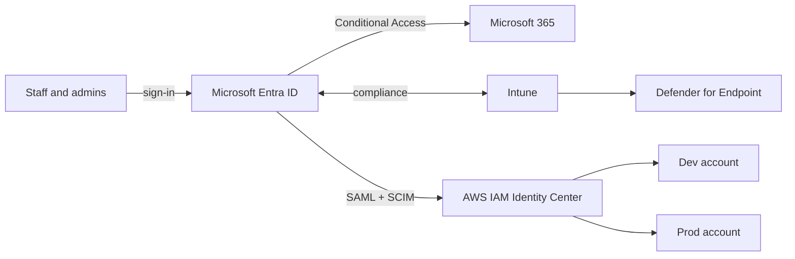

# Project 8: Secure Microsoft 365 & AWS Identity Lab

Build, secure, test and document a small Microsoft 365 and AWS identity
environment for a fictional regulated firm, with evidence an auditor would accept.

> **Status: Phase 0 (preparation).** Scripts, policy definitions, templates and
> the test plan are ready; nothing has been deployed yet. Results below are
> filled in from `evidence/test-results.md` as each phase passes.

## Scenario

**Harbourline Advisory** (fictional) is an 8-person financial advisory firm: an
Owner, one IT Administrator and six staff across Advice, Finance and
Development. It runs Microsoft 365 on Windows laptops and has a small AWS
footprint for its developers. Auditors expect identity, device and access
controls backed by evidence.

## What it demonstrates

| Skill | Where |
|-------|-------|
| Entra ID, Conditional Access, PIM | Phases 1–3 · `config/conditional-access/` · `scripts/graph/` |
| Intune, Autopilot, Defender for Endpoint | Phases 4–5 · `docs/runbooks/device-enrolment.md` |
| Owner / Admin / User tiers, break-glass, joiner-mover-leaver | `docs/runbooks/` · `Invoke-Leaver.ps1` |
| AWS Organizations, IAM Identity Center, least privilege | Phase 6 · `config/aws/` · `scripts/aws/` |
| SAML + SCIM federation (OIDC as stretch goal) | Phase 6 |
| ASD Essential Eight (ML1) | `docs/essential-eight-assessment.md` |
| As-built, runbooks, test evidence, exception register | `docs/` · `registers/` · `evidence/` |

## Architecture



Full design: [`docs/as-built.md`](docs/as-built.md).

## Progress

| Phase | Focus | Status |
|-------|-------|--------|
| 0 | Preparation: repo, VM, tools | In progress |
| 1 | Tenant and identity foundation | Not started |
| 2 | Conditional Access (CA001–CA006) | Not started |
| 3 | PIM and joiner-mover-leaver | Not started |
| 4 | Intune and Autopilot | Not started |
| 5 | Microsoft Defender | Not started |
| 6 | AWS workforce access | Not started |
| 7 | Documentation and publishing | Not started |

Tests passed: **0 / 35** ([`evidence/test-results.md`](evidence/test-results.md)).

## Repository layout

```
config/
  groups.json                  group design (dynamic rules, role-assignable flags)
  conditional-access/          CA001–CA006 + named location, as Graph JSON templates
  aws/                         permission sets, inline policy, guardrail SCP, budget
data/users.csv                 8 fictional staff
docs/                          as-built, Essential Eight, executive summary, runbooks/
evidence/                      test register and redacted screenshots
registers/                     exception register, remediation backlog
scripts/graph/                 Microsoft Graph PowerShell (PowerShell 7.2+)
scripts/aws/                   AWS CLI v2 checks (bash)
```

## How to reproduce

**Prerequisites:** PowerShell 7.2+, `Install-Module Microsoft.Graph -Scope CurrentUser`,
AWS CLI v2, `jq`, a Windows 11 Enterprise evaluation VM, a Microsoft 365 E5 trial
and a new AWS account. Every script that changes something supports `-WhatIf`;
run that first.

```powershell
# Phase 0
./scripts/graph/Test-LabPrereqs.ps1 -Connect

# Phase 1
$d = '<tenant>.onmicrosoft.com'
./scripts/graph/New-LabUsers.ps1 -Domain $d
./scripts/graph/New-LabGroups.ps1 -Domain $d          # -SkuPartNumber if the trial SKU differs
./scripts/graph/New-BreakGlassAccounts.ps1 -Domain $d

# Phase 2: always created report-only
./scripts/graph/New-LabCAPolicies.ps1
./scripts/graph/Set-LabCAPolicyState.ps1 -Policy CA001 -State enabled   # after reviewing sign-in logs
./scripts/graph/Export-LabCAPolicies.ps1

# Phase 3
./scripts/graph/Invoke-Leaver.ps1 -UserPrincipalName <upn> -RetireDevices -WhatIf
```

```bash
# Phase 6 (management account profile)
./scripts/aws/create-budget.sh you@example.com
./scripts/aws/check-account-baseline.sh
./scripts/aws/check-identity-center.sh
./scripts/aws/find-signin-events.sh 24
./scripts/aws/retire-legacy-iam-user.sh legacy-svc inspect
```

Portal-only steps (PIM role settings, Autopilot profile, compliance policy,
Defender onboarding, the Entra ↔ IAM Identity Center SAML/SCIM connection) are
documented in the build guide and recorded in the as-built.

## Safety rules

- Fictional users and data only. Never connect real personal or company accounts.
- Redact tenant IDs, domains, emails, IPs, account IDs and keys before committing.
  `out/` (passwords, logs) is git-ignored.
- AWS budget alert from day one; delete resources when finished.
- Cancel the Microsoft trial before it converts to paid.

## Out of scope

Apple Business Manager needs a real organisation with a D-U-N-S number, so it is
logged as **EX-001** in the [exception register](registers/exception-register.md).

## References

- [Microsoft Learn: Conditional Access](https://learn.microsoft.com/entra/identity/conditional-access/overview)
- [Microsoft Learn: Privileged Identity Management](https://learn.microsoft.com/entra/id-governance/privileged-identity-management/pim-configure)
- [Microsoft Learn: Emergency access accounts](https://learn.microsoft.com/entra/identity/role-based-access-control/security-emergency-access)
- [Microsoft Learn: AWS IAM Identity Center SSO (SAML) tutorial](https://learn.microsoft.com/entra/identity/saas-apps/aws-single-sign-on-tutorial)
- [Microsoft Learn: AWS IAM Identity Center provisioning (SCIM) tutorial](https://learn.microsoft.com/entra/identity/saas-apps/aws-single-sign-on-provisioning-tutorial)
- [ASD: Essential Eight Maturity Model](https://www.cyber.gov.au/business-government/asds-cyber-security-frameworks/essential-eight/essential-eight-maturity-model)

## Licence

MIT. See [LICENSE](LICENSE).
