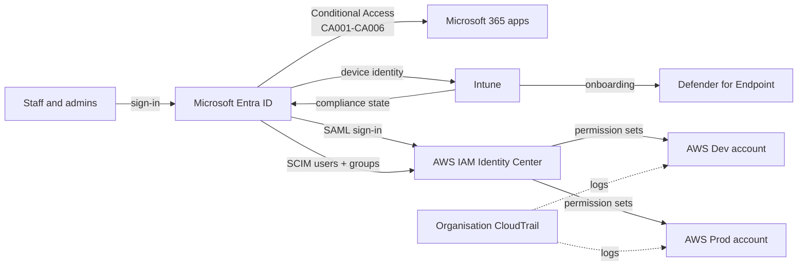

# As-built: Harbourline Advisory identity environment

> Fill in as you build. Fields marked `TBD` are recorded on the day; never paste
> tenant IDs, account IDs or real email addresses here.

| | |
|---|---|
| Document owner | Manraj Singh Makin |
| Version | 0.1 (draft, pre-build) |
| Last updated | 2026-10-25 |
| Tenant | `TBD`.onmicrosoft.com (Microsoft 365 E5 trial, activated `TBD`, expires `TBD`) |
| AWS organisation | Management + Dev + Prod (`ap-southeast-2`) |

## 1. Architecture

Entra ID is the single identity source; everything else trusts it.

## 2. Identities

| Persona | UPN prefix | Department | Standing roles | Eligible (PIM) |
|---------|------------|------------|----------------|----------------|
| Owner | olivia.owner | Management | none | none (approver for GA) |
| IT Administrator | alex.admin | IT | none | Global Admin, Intune Admin, Security Admin, User Admin |
| Staff ×6 | see `data/users.csv` | Advice / Finance / Development | none | none |
| Break-glass ×2 | bg-emergency-01/02 | - | Global Admin (permanent) | - |

## 3. Groups

Source of truth: `config/groups.json`.

| Group | Type | Rule / purpose |
|-------|------|----------------|
| SG-All-Staff | Dynamic | Enabled member users with a known department. Carries the licence; CA004 target |
| SG-Dept-Advice / -Finance / -Dev | Dynamic | `user.department` |
| SG-Admins-PIM | Assigned, role-assignable | Eligible admin roles |
| SG-BreakGlass | Assigned, role-assignable | Excluded from all CA. Role-assignable so only Privileged Role Admins / GAs can change membership |
| SG-AWS-Developers / SG-AWS-ReadOnly | Assigned | Provisioned to AWS by SCIM |

**Design note:** licences come from SG-All-Staff, which requires
`accountEnabled = true`. A leaver loses the licence automatically once disabled.

## 4. Conditional Access

Source of truth: `config/conditional-access/` (templates) and `config/conditional-access/exported/` (as deployed).

| ID | Purpose | Users | Apps | Condition | Control | State |
|----|---------|-------|------|-----------|---------|-------|
| CA001 | MFA everywhere | All − SG-BreakGlass | All | - | MFA | TBD |
| CA002 | Kill legacy auth (can't do MFA) | All − SG-BreakGlass | All | Client apps: EAS, other | Block | TBD |
| CA003 | Phishing-resistant MFA for admins | 15 admin roles (Microsoft's recommended 14 + Intune Admin) − SG-BreakGlass | All | - | Auth strength: phishing-resistant | TBD |
| CA004 | Only managed, healthy devices reach M365 data | SG-All-Staff − SG-BreakGlass | Office 365 | - | Compliant device | TBD |
| CA005 | Stop risky sign-ins (P2) | All − SG-BreakGlass | All | Sign-in risk: high | Block | TBD |
| CA006 | Geo-restrict to Australia | All − SG-BreakGlass | All | Location ≠ NL-Australia | Block | TBD |

Deployment: report-only first (`New-LabCAPolicies.ps1`), review sign-in logs, then
`Set-LabCAPolicyState.ps1 -State enabled`.

## 5. Privileged access (PIM)

See `runbooks/pim-activation.md` for role settings. Access review: quarterly on
SG-Admins-PIM, reviewer = Owner, auto-remove on no response: `TBD`.

## 6. Devices (Intune)

| Item | Setting |
|------|---------|
| Autopilot profile | User-driven, Entra joined, ESP on |
| Compliance policy | BitLocker, Secure Boot, firewall, Defender AV, min OS `TBD` |
| Security baseline | Windows security baseline `TBD version` |
| Windows LAPS | Backup to Entra ID, rotation `TBD` days |
| Office macros | Block macros from the internet |
| App Control for Business | Audit `TBD date` → Enforce `TBD date` |
| Update rings | `TBD` |

## 7. Defender for Endpoint

Onboarded via Intune EDR policy. ASR rules: `TBD list` (audit → block). Network protection: block. Web content filtering categories blocked: `TBD`.

## 8. AWS

| Account | Purpose |
|---------|---------|
| Management | Organizations, IAM Identity Center, org CloudTrail, billing. No workloads |
| Dev | Developer workloads |
| Prod | Production (lab: empty) |

**Permission sets** (`config/aws/permission-sets/`):

| Set | Policy | Assigned to | Session |
|-----|--------|-------------|---------|
| ReadOnly | AWS `ViewOnlyAccess` | SG-AWS-ReadOnly → Dev, Prod; SG-AWS-Developers → Prod | 4 h |
| Developer | Inline, Sydney-only, no IAM users/keys/roles, no trail tampering | SG-AWS-Developers → Dev | 4 h |
| Admin | `AdministratorAccess` | Nobody (temporary, approved, logged) | 1 h |

Optional guardrail SCP: `config/aws/scp-guardrails.json` (region lock, trail protection, no leaving the org).

SCIM: Entra enterprise app "AWS IAM Identity Center", scope = assigned users and groups, cycle ≈ 40 min.

## 9. Change log

| Date | Change | By |
|------|--------|----|
| 2026-10-25 | Initial design | MSM |
