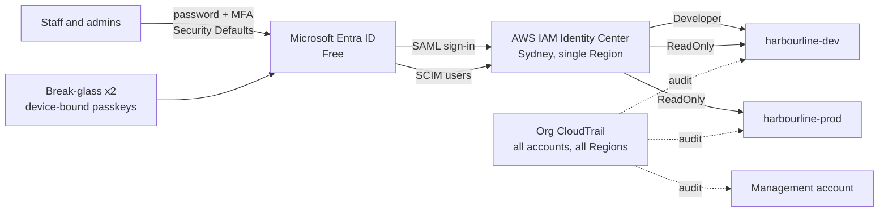

# As-built: Harbourline Advisory identity environment

| | |
|---|---|
| Document owner | Manraj Singh Makin |
| Version | 1.0 (as built and tested) |
| Last updated | 2026-11-21 |
| Identity tenant | `<tenant>.onmicrosoft.com`, display name **Harbourline Advisory**, country Australia, **Microsoft Entra ID Free** |
| AWS organisation | Management + `harbourline-dev` + `harbourline-prod`, home Region `ap-southeast-2` (Sydney) |
| Test results | 16 passed, 19 blocked by licensing (each with an exception), 0 outstanding: [`evidence/test-results.md`](../evidence/test-results.md) |

Identifiers (tenant ID, domain, AWS account IDs, IP addresses, key IDs) are redacted
throughout. Each section says whether it is **Deployed** (built and tested) or
**Design only** (written and ready for a licensed tenant, see EX-004).

## 1. Architecture

### As deployed

Entra ID is the single identity source. AWS trusts it for sign-in (SAML) and
receives users from it (SCIM). No human has a long-lived AWS credential.

### Target design (needs Entra ID P1/P2, Intune, Defender)

Adds Conditional Access CA001 to CA006, PIM, Intune/Autopilot device compliance and
Defender for Endpoint. See sections 4 to 7 and the exception register.

## 2. Identities (Deployed)

| Persona | Account | Department | Standing admin role | Notes |
|---------|---------|------------|---------------------|-------|
| Owner | olivia.owner | Management | none | Business approver |
| IT Administrator | alex.admin | IT | **none** | Gets a role only for a task, removed afterwards (tested, T3.1) |
| Staff ×6 | see `data/users.csv` | Advice, Finance, Development | none | Created by `New-LabUsers.ps1` |
| Leaver test | nina.patel | Advice (was Finance) | none | **Disabled**: joiner, mover, leaver tested (T3.4 to T3.6) |
| Break-glass ×2 | bg-emergency-01, -02 | none | Global Administrator (permanent) | Device-bound passkey + Authenticator, 40+ character passwords, weekly sign-in review |
| Build account | setup.admin | none | Global Administrator | To be removed after the build (RB-004) |

**Authentication:** Security Defaults **on**. Every user must register Microsoft
Authenticator and is prompted for MFA; admins every time (T1.4). Legacy
authentication is blocked by Security Defaults.

## 3. Groups (Deployed as assigned groups)

Source of truth: `config/groups.json`.

| Group | Members (deployed) | Purpose |
|-------|--------------------|---------|
| SG-All-Staff | all enabled staff with a department | Licence target and CA004 scope in the target design |
| SG-Dept-Advice / -Finance / -Dev | by `department` | Department access |
| SG-AWS-Developers / SG-AWS-ReadOnly | sam, ella / alex | Record of AWS entitlement (see EX-011) |
| SG-BreakGlass | bg-emergency-01, -02 | Exclusion group for Conditional Access in the target design |
| SG-Admins-PIM | empty | PIM eligibility in the target design |

On Entra ID Free, dynamic and role-assignable groups are unavailable.
`New-LabGroups.ps1 -FreeTier` reproduces the dynamic rules from the department
attribute (adds **and** removes members) and is run after every joiner, mover or
leaver (EX-006, EX-007). Membership verified independently from the tenant (T1.1).

## 4. Conditional Access (Design only: EX-005)

Policies are kept as Graph JSON in `config/conditional-access/` and deploy with
`New-LabCAPolicies.ps1` (always report-only first; refuses any policy that does not
exclude SG-BreakGlass). CI fails the build if a policy loses the break-glass exclusion.

| ID | Purpose | Users | Apps | Condition | Control |
|----|---------|-------|------|-----------|---------|
| CA001 | MFA everywhere | All − SG-BreakGlass | All | - | MFA |
| CA002 | Block legacy authentication | All − SG-BreakGlass | All | Client apps: EAS, other | Block |
| CA003 | Phishing-resistant MFA for admins | 15 admin roles − SG-BreakGlass | All | - | Auth strength: phishing-resistant |
| CA004 | Managed, healthy devices only | SG-All-Staff − SG-BreakGlass | Office 365 | - | Compliant device |
| CA005 | Block risky sign-ins (P2) | All − SG-BreakGlass | All | Sign-in risk: high | Block |
| CA006 | Australia only | All − SG-BreakGlass | All | Location ≠ NL-Australia | Block |

**Compensating control on Free:** Security Defaults (covers CA001, CA002 and part of CA003).

## 5. Privileged access (Deployed: manual just-in-time; PIM design only, EX-008)

| Control | State |
|---------|-------|
| Standing admin roles for staff | **None** |
| Admin task | Least-privileged role (for example User Administrator, not Global Administrator) assigned for the task and removed straight after. Tested: granted 1:06, used 1:10, removed 1:16, all in the audit log (T3.1) |
| Break-glass | Two cloud-only Global Administrators, device-bound passkeys, sign-ins reviewed weekly (REV-001) |
| PIM, access reviews | Design only: settings in `docs/runbooks/pim-activation.md` |

## 6. Tenant hardening (Deployed)

Defaults changed after findings during testing (remediation backlog):

| Setting | Value | Ref |
|---------|-------|-----|
| Guest invitations | Only users in specific admin roles | RB-002 |
| Microsoft Entra admin center for non-admins | Restricted (403 verified) | RB-003 |
| Users can register applications / agent blueprints | No | RB-006 |
| Non-admin users can create tenants | No | RB-007 |
| Users can create security groups | No | RB-008 |
| LinkedIn account connections | No | RB-009 |
| Guest user access | Limited (default kept) | |

## 7. Devices and Defender (Design only: EX-009)

Windows 11 Enterprise VM `HL-WIN11-01` is built (TPM 2.0, Secure Boot, Autopilot-ready
serial, clean snapshot, T0.2). Intune, Autopilot, compliance, LAPS, App Control and
Defender for Endpoint are documented in the runbooks but not deployed (no licence).

## 8. AWS (Deployed)

### Accounts

| Account | Purpose |
|---------|---------|
| Management | Organizations, IAM Identity Center, org CloudTrail, billing. No workloads |
| harbourline-dev | Developer workloads |
| harbourline-prod | Production (lab: empty) |

Member accounts were created without root passwords, and **centralised root access**
is enabled (root credentials management and privileged root actions), so root-only
tasks run from the management account.

### IAM Identity Center

- Organisation instance, **single Region (ap-southeast-2)**, **AWS owned key**. The
  console default (multi-Region replicated to US West, customer managed KMS key) was
  rejected for data residency and cost.
- Identity source: **external IdP = Microsoft Entra ID (SAML 2.0)**. Users cannot be
  created in AWS any more; Entra is the source of truth.
- **SCIM** automatic provisioning, scope *assigned users only*, failure emails on.
  Users are assigned to the AWS app individually (EX-011: group assignment needs P1).

### Permission sets and assignments

| Set | Policy | Session | harbourline-dev | harbourline-prod |
|-----|--------|---------|-----------------|------------------|
| ReadOnly | AWS `ViewOnlyAccess` (no S3 object or secret reads) | 4 h | alex | sam, ella, alex |
| Developer | Inline: build services **in Sydney only**, small EC2 types only, no IAM users/keys/roles, no CloudTrail changes | 4 h | sam, ella | - |
| Admin | `AdministratorAccess` | 1 h | nobody | nobody |

Tested: SSO through Entra (T6.2); the same user can create an S3 bucket in Dev but is
denied in Prod (T6.3) and denied outside Sydney; unassigning a user in Entra disables
them in AWS within seconds (T6.4).

### Logging and cost guardrails

| Control | Setting |
|---------|---------|
| Org CloudTrail `harbourline-org-trail` | All accounts, all Regions, management events (read + write), log file validation on, SSE-S3 (no KMS cost), no CloudWatch Logs; logging verified (T6.1, T6.5) |
| Budget | `lab-monthly-cost`, US$5/month, email alerts verified |
| Root (management) | Passkey MFA, no access keys |
| IAM users | **0**: the stand-in legacy user was found in the credential report, deactivated and deleted (T6.6) |
| SCP guardrails | Written (`config/aws/scp-guardrails.json`), **not yet attached** (RB-011) |

## 9. Change log

| Date | Change | By |
|------|--------|----|
| 2026-10-25 | Initial design, scripts and test plan | MSM |
| 2026-11-20 | Tenant on Entra ID Free; `-FreeTier` group sync; exceptions EX-004 to EX-011; Phase 1 built | MSM |
| 2026-11-21 | Tenant hardening; least-privilege and lifecycle tests; AWS Organizations, Identity Center federation, permission sets, org CloudTrail; legacy IAM user retired. Version 1.0 | MSM |
